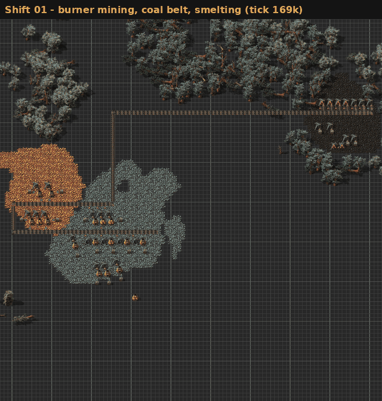
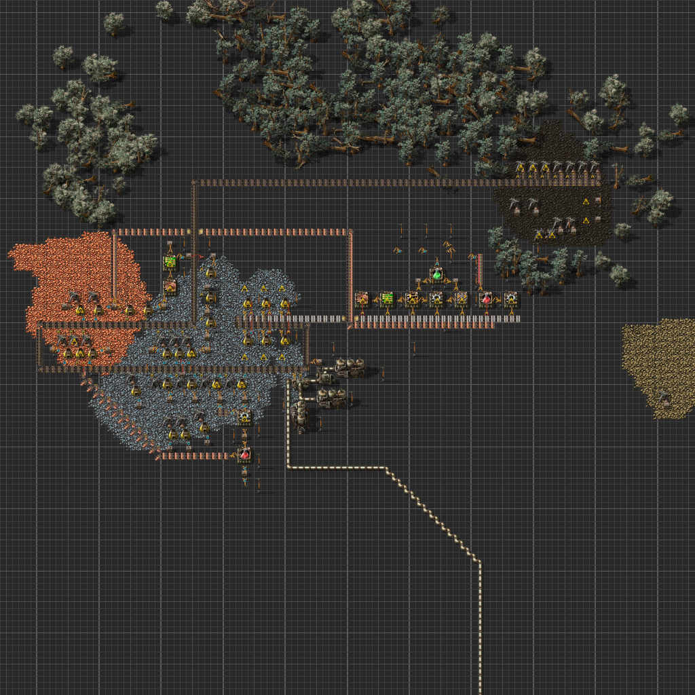
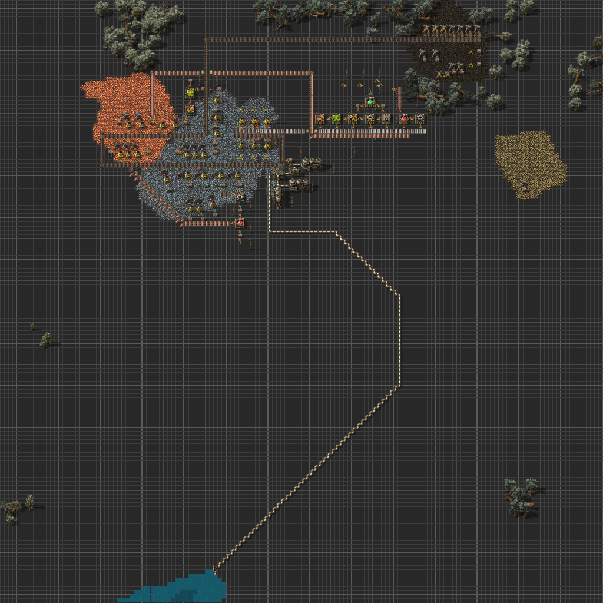
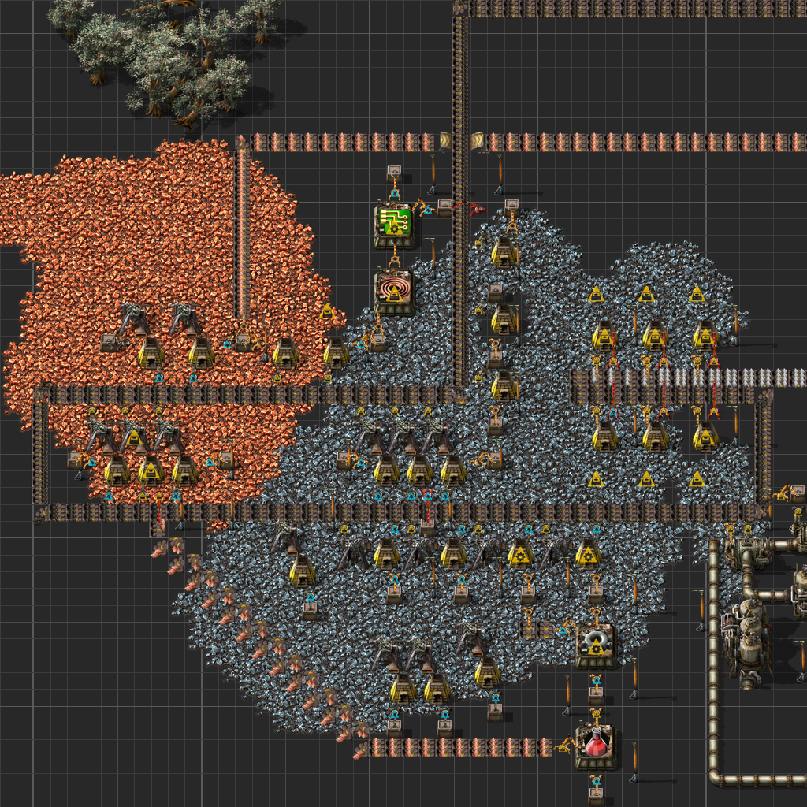
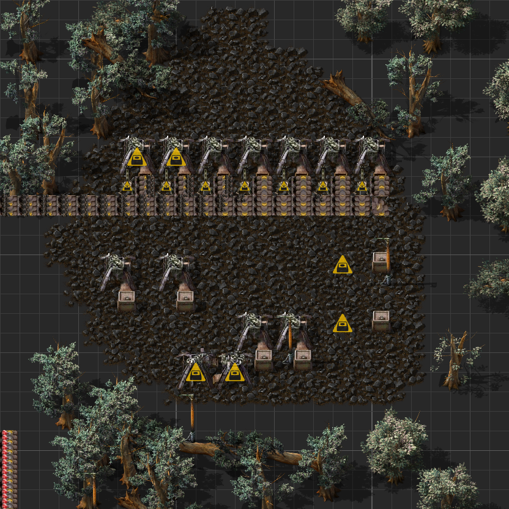
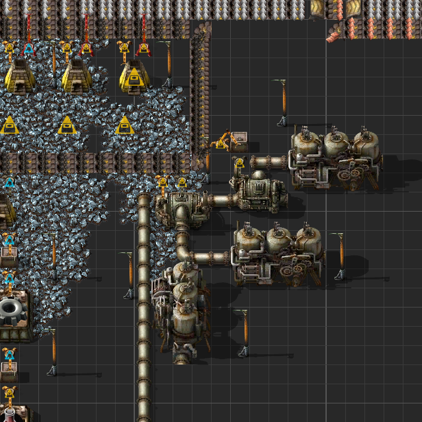
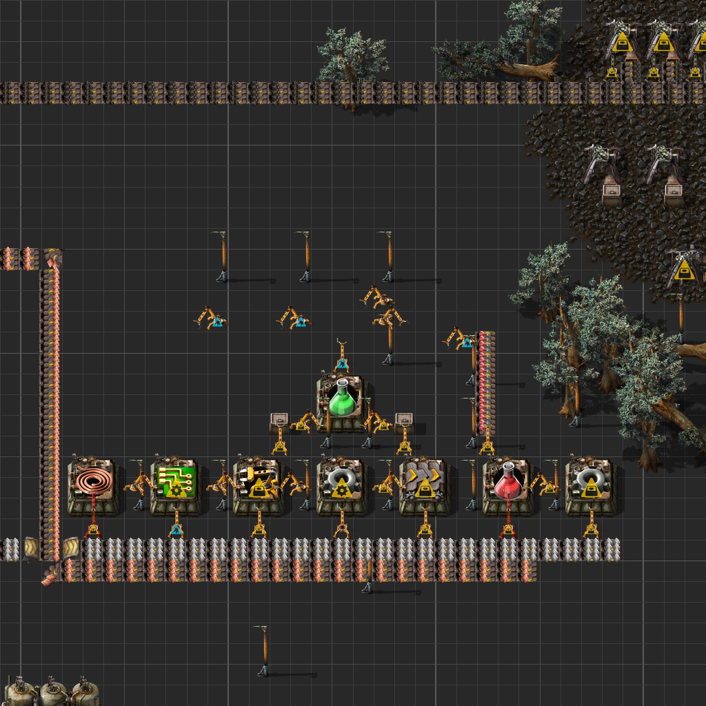

# run-01: from 8 iron plates to automated red + green science

Claude Code subagents (`factorio-player`, one per shift, never in parallel) played three shifts of
Factorio 2.0.73 through the Factorio Learning Environment (FLE). They started from a vanilla start
on the `open_world` map (seed 44340): 8 iron plates, 1 burner mining drill, 1 stone furnace, and no
research. By the end of shift 03, about 136 game-minutes in, the base had steam power from 2 boilers
and 3 engines (2.7 MW), belt-fuelled and electric smelting columns, automated circuits, and a science
block that makes red science at about 12/min and green at 5/min. Four labs research both packs
without anyone feeding them. The agents placed every entity through FLE's Python API from a REPL;
nobody used the game UI. The full per-shift handoffs are in [`JOURNAL.md`](JOURNAL.md).



*The same map area (x −42.5…53.5, y −115.5…−19.5) at the end of each shift and at the final
snapshot. The shift renders were taken at different zooms, so each one was aligned to the final
render by template matching and cropped to this window. Shift 02's render covered a smaller area;
the grey border in that frame is outside it.*

## Milestones by shift

| Shift | Goal | Result | Executions | Game tick | Milestones reached |
|---|---|---|---|---|---|
| 01 | Bootstrap; automate iron, copper and coal | DONE | 52 / 110 | 169,206 (~47 min) | M0–M3, M3b: 7 self-fuelling coal drills feed a coal trunk belt; 11 iron and 5 copper drill→furnace pairs (10 belt-fuelled); Steam power and Electronics unlocked by trigger |
| 02 | Fix at-risk entities, steam, Automation, gears, red science | DONE | 68 / 110 | 354,114 (~98 min) | M4 steam (boiler + 2 engines, belt-fed); M5 Automation researched; M6 automated gears; M7 red science (~5–6/min); M8 7 electric drills; M9 circuits (~7/min) |
| 03 | Boiler redundancy, red ≥10/min, green science, automatic research | DONE | 63 / 110 | 491,637 (~136 min) | M10 green 4.8/min with all inputs automated; red 12/min from 2 assemblers; 4 labs on red+green; Automation 2 done; 2nd boiler and 3rd engine (2.7 MW); circuits ~17/min |

## Final stats (live snapshot, tick ~530k–536k)

**Measured automated rates.** These come from the force production statistics and assembler
`products_finished` over **3,650 ticks = 60.8 game-seconds** (tick 532,284 → 535,934). The window
is measured as a tick delta, not taken from the nominal `advance()` time.

| Item | Rate |
|---|---|
| Automation (red) science pack | **11.9 / min** (2 assemblers) |
| Logistic (green) science pack | **5.0 / min** (1 assembler; the AM1 cap is 5/min) |
| Electronic circuit | 23.9 / min |
| Iron gear wheel | 27.9 / min |
| Iron plate | 258.8 / min |
| Copper plate | 104.5 / min |

**Production totals over the run** (`produced()` / force production statistics):

| Item | Total | | Item | Total |
|---|---|---|---|---|
| Iron ore | 25,644 | | Iron plate | 25,126 |
| Copper ore | 11,457 | | Copper plate | 11,288 |
| Coal | 17,069 | | Stone | 1,373 |
| Iron gear wheel | 2,914 | | Copper cable | 4,446 |
| Electronic circuit | 1,226 | | Transport belt | 1,102 |
| Inserter | 295 | | Small electric pole | 116 |
| Automation science pack | 703 | | Logistic science pack | 172 |

**Research.** Researched: steam-power, electronics, automation, electric-mining-drill, logistics,
steel-processing, logistic-science-pack, fast-inserter, automation-2 (plus
automation-science-pack, which FLE pre-researches). In progress: **logistics-2 at 63%**. Queued after
it: electric-energy-distribution-1, then advanced-material-processing.

**Entities on the map (830, excluding the character):**

| Entity | Count | | Entity | Count |
|---|---|---|---|---|
| transport-belt | 360 | | pipe | 177 |
| small-electric-pole | 54 | | inserter (electric) | 55 |
| burner-inserter | 42 | | iron-chest | 34 |
| burner-mining-drill | 30 | | stone-furnace | 27 |
| electric-mining-drill | 13 | | assembling-machine-1 | 12 |
| long-handed-inserter | 11 | | lab | 5 |
| underground-belt | 4 | | steam-engine | 3 |
| boiler | 2 | | offshore-pump | 1 |

**Health at snapshot.** 2/2 boilers and 3/3 engines were working, with power at 980 kW drawn of
2.7 MW capacity. 21 furnaces were working and 5 were output-full. 25 burner drills were working and
5 were output-blocked. Of the 13 electric drills, 3 were working and 10 were output-blocked, because
their belts are backed up. Of the 12 assemblers, 5 were working and 7 were output-full. Output-full
means the assembler is starved downstream, not that it is broken. 2 of the 4 science-block labs were
busy at the moment of sampling, and the other two had only green packs left.

## Gallery

### Whole base



*World x −45.5…66.5, y −121.5…−9.5. Left: the copper ore patch (orange) and iron ore patch (blue-grey)
carry the smelting columns. Top right: the coal field, with the long coal trunk belt running west
across the top and down into the smelting block. Centre right: the science block. Centre: the power
plant, with the water pipe leaving it towards the south. Far right: the stone patch, which has one
drill.*



*Wider view (x −63.5…80.5, y −101.5…42.5). The offshore pump sits on the lake at the bottom. A pipe
of about 170 segments carries water north to the boilers at the base. The agent chose to bring the
water to the coal and smelting instead of building power at the lake.*

### Smelting columns



*x −41.5…6.5, y −92.5…−44.5. The coal trunk belt comes down the middle (vertical belt) and splits into
horizontal fuel belts. Burner drills sit on the ore and drop straight into stone furnaces, and
inserters refuel both from the coal belts. Left half: the copper columns. Centre and bottom: the
iron columns, which are the shift 01 pairs plus the shift 02 side-by-side row. Top centre: the
circuit line (cable AM, then circuit AM, then chest). Right (x −8…2): the shift 03 electric iron
rows, whose outputs go onto the white iron belt heading east to the science block. Bottom centre:
the original gear AM above the first red-science AM, which feeds the old lab. The diagonal
"staircase" belt carries copper to that red AM.*

### Coal belt



*x 31.5…57.5, y −102.5…−76.5. The top row holds 7 burner drills that face down onto the trunk belt.
A burner inserter under each drill takes coal back off the belt and refuels the drill, so the coal
unit fuels itself. The lower drills fill chests: these are a hand-refuelling buffer, plus 2
electric drills on the right that drop into chests.*

### Power plant



*x −6.5…15.5, y −70.5…−48.5. The water pipe comes up from the south (vertical pipe, left). Boiler 1
is fed coal from the trunk belt by one electric and one burner inserter, which gives a redundant
feed. Its water chains to boiler 2 (top), which gets its coal through a 1-slot buffer chest. Three
steam engines (2.7 MW) power a single small-pole network that reaches the smelting block, the
science block and the coal field.*

### Science block



*x 8.5…42.5, y −96.5…−62.5. The bottom row of assemblers, from left to right: copper cable, circuit,
inserter, gear, transport belt, red science #2, gear #2. Inserters feed them from the iron belt
(white) and the copper belt (orange) underneath. The green-flask assembler above the row combines
the inserter and belt outputs into logistic science. Above it, at y ≈ −81.5, are **4 labs that
FLE's renderer does not draw**: only their inserters and poles show. The vertical belt on the right
carries red packs from red AM #2 to the labs.*

> **Renderer limitations.** FLE's sprite renderer has no sprites for **labs** or **electric mining
> drills**. Electric drills show only as a yellow status triangle (most of them are "waiting for
> space", because their belts are full). Labs do not appear at all. The yellow triangles on burner
> entities are status icons too. The character also appears in each shot, because the renderer
> centres on the player.

## Honest notes: what was hand-fed or helped by workarounds

- **Hand-fuelled legacy lines.** Some early lines never got belt fuel: 4 old iron drills, 2 old
  copper drills, the coal-chest drills and the stone drill. The player refuelled them by hand every
  shift; they had 40 coal at about tick 477k. No science chain depends on them. Early on, the middle
  furnaces in two of the shift-01 columns had no output inserter and the player emptied them by hand.
  A long-handed inserter fixed both in shift 02/03.
- **Hand-crafting.** The character hand-crafted the buildings: pump, boiler, engines, assemblers,
  labs, poles and belts. This is normal Factorio, but it means the base does not build itself.
- **Research queue via Lua.** FLE's `set_research` lacks some enums, so the player queued techs with
  `game.forces.player.add_research(...)` in Lua. The research itself runs on automated packs.
- **Lua fixes for FLE API gaps.**
  - Underground belt outputs were re-created with `create_entity{type='output'}`, because FLE always
    places an input.
  - The 1-slot chest limits (`set_bar`) were set via Lua.
  - A water-flooded steam engine was cleared with `fluidbox[1]=nil`.
  - Lab and assembler state was read via Lua, because FLE's `get_entity(Lab)` raises an error.
  - A dead tree and a rock that blocked placement were removed with `harvest_resource` after walking
    there. That is legitimate gameplay.
- **Peaceful map.** FLE removes biters, and `make_peaceful()` removes worms and sets peaceful mode.
  Defence was never a concern.
- **Turn-based clock.** The game is paused between agent programs (`--pause-between`), so thinking
  time cost no fuel. While programs run, the game runs at speed 10.
- **Pre-researched.** FLE pre-researches `automation-science-pack`. Every other tech was earned by
  smelting triggers or by labs.

## How to view it yourself

- **Images.** All PNGs are in [`renders/`](renders/). The per-shift renders are `shift-NN*.png`; the
  final ones are `final-*.png`.
- **In Factorio 2.0.** Copy [`saves/run-01-final.zip`](saves/run-01-final.zip) (end of run) or
  [`saves/run-01-shift-03.zip`](saves/run-01-shift-03.zip) into your Factorio saves folder:
  `%APPDATA%\Factorio\saves` on Windows, `~/.factorio/saves` on Linux, or
  `~/Library/Application Support/factorio/saves` on macOS. Then choose **Single player → Load
  game**. Earlier shifts are in `saves/run-01-shift-0{1,2}.zip`.
- **Restart the docker stack from a save** (from the repo root):
  ```bash
  cp runs/run-01/saves/run-01-shift-03.zip .fle/saves/
  FLE_SAVE=run-01-shift-03 docker compose up -d --force-recreate --wait
  ```
  To use the final save instead, copy `run-01-final.zip` and set `FLE_SAVE=run-01-final`.
- **Walk around in the live game.** `docker-compose.yml` publishes the game port
  **UDP 34197** on all interfaces (`${FLE_GAME_PORT:-34197}:34197/udp`). A real **Factorio 2.0.73**
  client can join the running stack with **Multiplayer → Connect to address →
  `<host>:34197`** and walk around the base. The client version must match the server's 2.0.73.
